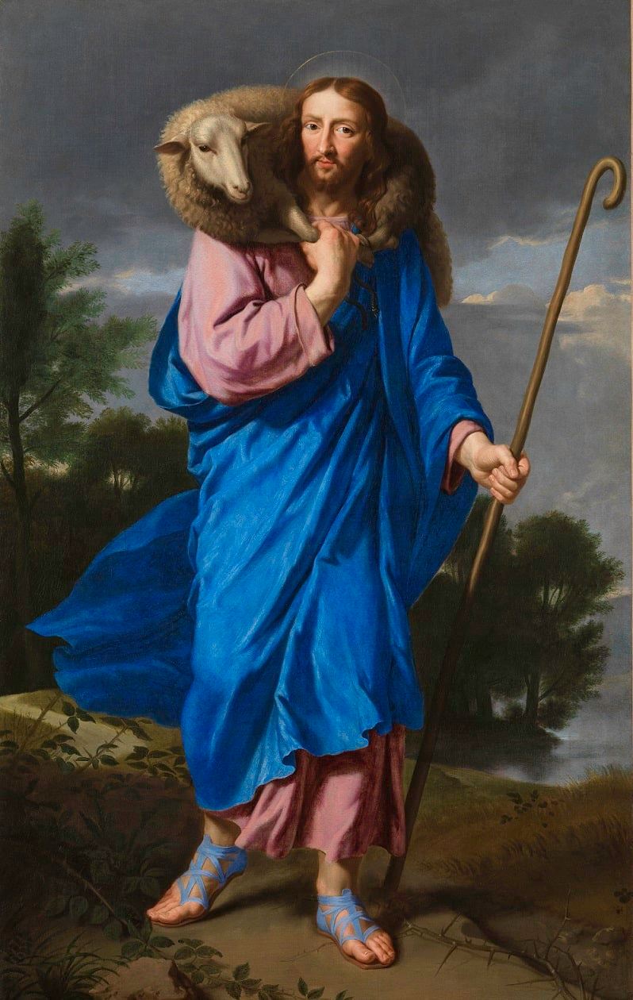

# MHRI · Magnifica Humanitas Redemptoris Iesu

**[Visit mhri.net](https://mhri.net/)**

An immersive, full-viewport presentation of *Le Bon Pasteur* (*The Good Shepherd*). The intention is to give the viewer the feeling of standing inside the painting: the figure remains the centre of attention, while landscape, atmosphere, light and a restrained movement of fabric create depth.

This repository contains the complete demonstration site, its artwork assets, and the Fly.io deployment workflow. A small native Node.js server serves the built React application and a same-origin location/weather API. Visitors need no account, GPS permission, or API key. Local time, modeled weather and season can now change the landscape while preserving the original painted figure.



## The artwork and the attribution

The principal catalogue reference is the [Musée national de Port-Royal des Champs record for *Le Bon Pasteur*](https://port-royal-des-champs.fr/le-bon-pasteur/), inventory **1962.1.003**. It lists **Jean-Baptiste de Champaigne (1631–1681)**, oil on canvas, unsigned and undated, while discussing uncertainty between Jean-Baptiste and his uncle Philippe. A closely related version belongs to the Musée des Beaux-Arts de Tours, inventory **801.1.4**.

The museum connects the commission to Renaud de Sévigné and Port-Royal, suggesting 1662–1663; its account places the Paris community’s version by Easter 1664. It also proposes an older Flemish visual source in Bruegel’s Good Shepherd composition. These are catalogue findings and proposals, not a claim that every attribution or date is settled. [Museum record](https://port-royal-des-champs.fr/le-bon-pasteur/)

The reproduction in this repository is the **798 × 1260 pixel image supplied for the project**. Its exact photographic source has not been independently established. The catalogue reference documents the composition and attribution debate; it is not presented as proof of this file’s original download location. Closely related versions should not be identified solely from generic online captions.

## Research and iconography

### The recovered sheep and the Good Shepherd

The image combines themes that should be distinguished when interpreting it:

- **Luke 15:3–7:** the shepherd searches for the lost sheep, carries it home on his shoulders, and rejoices. The carried animal makes this passage especially relevant to the pose. [Luke 15](https://bible.usccb.org/bible/luke/15)
- **Matthew 18:12–14:** the search for the straying sheep expresses concern that none of the little ones should be lost. This places rescue within a wider theme of care for the vulnerable. [Matthew 18](https://bible.usccb.org/bible/matthew/18)
- **John 10:1–18:** the shepherd, gate, flock, thief and hired hand form a different, extended discourse. Christ’s willingness to give his life for the sheep connects protection with sacrifice. [John 10](https://bible.usccb.org/bible/john/10)

These passages inform the project’s reading of the painting. The site does not attempt a complete theological commentary, and the added motion is a present-day interpretation rather than historical evidence.

### The earlier sheepfold engraving

An engraving discussed during the project was **The Parable of the Good Shepherd**, **1565**, engraved by **Philips Galle after Pieter Bruegel the Elder**. The Metropolitan Museum of Art records an impression as **53.601.15(60)**, an engraving in its fourth state. [Met collection record](https://www.metmuseum.org/art/collection/search/383049)

In the supplied engraving, Christ stands in the doorway carrying a sheep while intruders attack the sheepfold around him. The inscription above the doorway, **EGO SVM OSTIVM OVIVM**, means “I am the door of the sheep.” This is the language of John 10:7: the doorway is part of the meaning, not merely a building in the background. The calm central figure and the disorder around the roof and walls create an opposition between care and predation. This paragraph is a visual reading of the supplied print, with the inscription translated here. [John 10](https://bible.usccb.org/bible/john/10)

The engraving provided an iconographic and lettering reference during design. It is not embedded in the live scene, and this project does not claim that a specific surviving impression was the painter’s direct source. The finished MHRI lettering is also not a tracing of the engraving’s inscription.

### Looking at the painting’s composition

The following observations describe the supplied reproduction and explain design decisions. They are the project’s visual interpretation, not quotations from a catalogue.

| Element | What it contributes to the composition | How the website treats it |
| --- | --- | --- |
| Face and sheep | The close placement of the two heads makes care visible as a physical relationship. The viewer’s attention returns to Christ’s face. | Facial features and the animal are kept still within the animated figure. |
| Blue mantle | The strongest cool colour occupies a large central area. Its folds establish weight and direction, while the projecting left edge suggests movement. | The original painted fabric is mapped onto a deformable mesh; only the loose region receives a small breeze. |
| Pink tunic and warm flesh | Warm notes interrupt the blue, especially at the face and hands. | Colour relationships come from the supplied reproduction; the figure is not repainted. |
| Shepherd’s crook | The long diagonal answers the upright figure and connects hand, sky and ground. | It has its own precise mask, so its narrow edges remain stable and the gap beside the robe stays open. |
| Halo | A very fine painted arc marks the head without dominating the sky. | The painted arc is retained, with a separate soft golden aureole behind the head. |
| Trees, water and distant sky | Overlapping forms and differences in scale lead the eye into the distance. | The scene expands sideways into an interpretive landscape with separate cloud, tree and foreground treatments. |
| Feet, path and brambles | The lower edge gives the figure a physical place to stand and introduces roughness into an otherwise calm presentation. The brambles invite a devotional reading of suffering along the path. | Persistent contact and cast shadows connect the feet to the extended ground. |

The blue is described as a visible colour, not as an identified historical pigment. No pigment analysis, conservation investigation, or new attribution research was undertaken for this demonstration.

## From a portrait painting to an immersive scene

The presentation is **2.5D**: painted surfaces move at different depths, and a local mesh deforms the fabric. It is not a recovered three-dimensional model of the historical scene.

The complete figure remains visible on both wide and narrow screens. Instead of cropping the portrait to fill a landscape screen, the background extends to the viewport edges. The original reproduction remains available through **About the painting → Show original painting**, allowing comparison with the unanimated portrait.

### Layers and depth

| Layer | Asset or implementation | Purpose |
| --- | --- | --- |
| Distant clouds | `public/art/cloud-sky.png` | A separate sky plate drifts very slowly behind the stationary tree silhouettes. |
| Middle-distance landscape | `public/art/landscape-wide.png` plus `landscape-foreground-mask.svg` | The extended landscape fills the viewport; its sky is masked so cloud motion does not move the trees. |
| Local environment variants | `public/art/environments/*.webp` | Separate painted landscapes and skies support time of day, seasons, wet ground and snow cover. |
| Moon | `src/moon.tsx` and SunCalc | A separate shaded disc follows the calculated phase, orientation and horizon visibility; dense clouds hide it. |
| Weather atmosphere | `src/weather-effects.tsx` | Wind-influenced rain, snow and hail, restrained mist and ground ripples add depth without repainting the figure. |
| Near landscape | The same landscape, revealed with a lower-edge mask | A small opposing parallax movement provides foreground depth. |
| Golden aureole | A circular CSS radial gradient | Sits behind the head and responds at an intermediate parallax depth. |
| Ground shadow | Figure and crook silhouettes projected onto a Canvas 2D receiver | A single cast shadow stays anchored at the toe contacts, recedes back and right, and follows the moving cloth. |
| Crook and painted halo | Independent SVG masks sampling the original reproduction | Preserve thin details without carrying blocks of the old background along with them. |
| Christ and sheep | Original pixels on a WebGL mesh, with an SVG fallback | Keep the subject recognisable while allowing a small area of cloth to move. |
| Interface | MHRI at upper left; copyright and About at the bottom | Offers identity and controls with minimal competition for the painting. |

The landscape and sky plates are **AI-generated interpretive extensions made for this project**. They do not reveal missing parts of the historical canvas. The additional glow, ground shadows, parallax, depth blur, environmental colour integration and cloth movement are also modern interventions. The subject’s texture comes from the supplied painting; its silhouette masks and display geometry are project work.

### Compositing the figure into the landscape

The painting already contains its own illumination. An HDRI normally supplies environment lighting to a rendered scene; applying one to this flat painted surface would not reconstruct the figure’s anatomy, material response or surface normals. This presentation instead borrows restrained techniques from image compositing. [Blender’s environment-lighting documentation](https://docs.blender.org/manual/en/latest/render/lights/world.html)

- **Clean mattes:** the free mantle edge follows the painted cloth, excluding the old ground and leaves beneath it. The same silhouette drives the animated mesh and static fallback.
- **Figure-derived cast shadow:** the current figure and crook silhouettes are projected onto the ground. Its direction and perspective compression are fitted to the original painting: it travels back and right from the feet. The footprint is generated from the subject, with no independent sandal outlines or oval contact patches. Figure translation matches the near-ground layer, with gentler card rotation.
- **Inner-edge light wrap:** the normal WebGL view samples a 64 × 32 colour reference made from the extended landscape. Its mapping follows the responsive cover crop and parallax. A soft band roughly three original-image pixels wide blends a small amount of the adjacent environment into the subject’s edge, without expanding the silhouette or changing its opacity. It produces no outward glow.
- **Restrained colour bounce:** shaded lower folds receive a very small environmental colour adjustment. It is an artistic approximation, not physically based relighting; the face and bright areas receive no bounce adjustment.

The colour reference is an ordinary low-dynamic-range image, **not an HDRI map**. It does not simulate reflections or recover missing geometry. The source reproduction is unchanged, and **Show original painting** bypasses all these interventions. Neuromancer keeps its separate RGB treatment. If WebGL or the landscape colour reference is unavailable, the normal painted colours remain available; the corrected silhouette and ground shadows do not depend on the colour-integration pass. The small edge texture is refreshed when the environment plate changes, and the additional GPU textures are released with the renderer.

### Fabric mesh

`src/figure-mesh.tsx` builds a connected **64 × 100 grid**, producing **12,800 triangles**. A texture is prepared once from the original reproduction and the corrected figure mask.

A weighted vertex shader limits movement to the free left side of the blue mantle. Influence fades towards the body and before the feet and upper torso, keeping the face, hands, sheep and feet anchored. Small sinusoidal changes in position, shallow depth and shading create the impression of a breeze. This is deliberately restrained: broad distortion would make the painting feel elastic.

The renderer caps pixel density at 2, responds to resizing, pauses when the tab is hidden, and releases GPU resources on cleanup. If WebGL is unavailable or its context is lost, the masked SVG figure remains visible. The crook is rendered separately rather than being distorted with the cloth.

### Dynamic ground shadow

`src/figure-shadow.ts` samples the existing silhouette curves, applies the same cloth displacement and perspective as the displayed figure, and projects the resulting contour onto a ground receiver inferred from the painted toe contacts. The crook contributes its own silhouette to that same shadow. The receiver compresses distance into a shallow receding ground band, matching the original shadow’s direction without letting a tall flattened figure climb up the background.

Three overlapping height bands produce a tight edge near contact and a wider penumbra farther from the feet. Their masks are combined before applying shadow density, so overlapping limbs do not create multiple stacked dark outlines. The cast is shallow, between 0° and approximately 16° above the rightward horizontal. It retains the landscape texture through a multiply blend, then fades smoothly to full transparency a short distance behind the figure. A second soft boundary limits its backward reach to the nearby ground. Both fades are applied after blur, preventing the penumbra from leaking into the water or distant trees; the toe contacts stay fixed.

The shadow uses the mesh’s animation clock and updates at up to 30 frames per second. Motion off and reduced motion keep the cast static; **Show original painting** hides it. If WebGL is unavailable or lost, a resting silhouette still casts a shadow through Canvas 2D while the figure uses its SVG fallback. This is a projection fitted to the visible painting, not a recovered three-dimensional model or a measured historical light source.

### Parallax and clouds

Pointer movement, touch dragging and arrow keys steer the scene. Position changes are eased rather than applied abruptly, and a small idle drift prevents complete stillness when motion is enabled.

At **1×**, horizontal cloud movement completes a cycle in two minutes, with an amplitude of 30 CSS pixels. At **4×**, the cycle takes 30 seconds, producing an obvious drift. Vertical motion has a different period and a smaller three-pixel amplitude. Extra sky overscan covers the increased travel without exposing empty edges. The default is **3×**. The **Cloud speed** slider ranges from **0× to 4×** and integrates speed over time, so changing speed does not jump the clouds to a different position. Cloud motion is independent of the Depth slider and stops when Motion is off.

## Local time, weather, seasons and the moon

**Local time & weather** starts enabled and can be turned off in **About the painting** to restore the established landscape. Automatic conditions use the visitor's approximate city-level coordinates and IANA time zone, not the Fly machine's Toronto location or a single time zone for an entire country. IP geolocation can reflect a VPN exit, mobile carrier or internet provider. **Not your area? Choose a city** provides a city search and explicit override; **Use my approximate IP location** removes that override.

The browser refreshes environment data every 30 minutes while visible and checks again after a long absence. A minute clock updates the astronomical scene between weather refreshes. If a provider fails, known location remains useful for the sun, moon and season, but weather is marked unavailable. Without any known location, the device clock supplies a simple time-of-day fallback; the app does not invent a geographically visible moon or claim guessed weather is current. Weather observations older than three hours are not used.

### Painted variants and atmospheric interpretation

Fourteen generated WebP assets provide nine landscapes—dawn, dusk, night, spring, summer, autumn, dormant winter, rain and snow—and five sky plates—dawn, dusk, night, clear and overcast. They are alternatives to the project's extended landscape, not alterations of `le-bon-pasteur.png` or discovered historical versions. The [generation record](docs/environment-art-prompts.md) contains the prompts and source references; [the manifest](public/art/environments/manifest.json) records dimensions and hashes.

Time, season and weather are separate inputs. Seasonal foliage is preserved with runtime lighting treatments for dawn, dusk and night. Rain or hail uses the rain landscape in summer/tropical scenes, while retaining spring, autumn or dormant winter foliage with wet lighting and precipitation in those seasons. Snowfall selects the separate snow landscape. **Winter does not automatically mean snow:** the winter asset shows dormant vegetation without snow, while snowfall selects its own asset and particles. Meteorological seasons reverse in the southern hemisphere. Tropical locations retain green foliage instead of receiving an artificial northern winter. These are artistic climate generalizations; they do not model every local biome or accumulated snow depth.

WMO weather codes distinguish clear, cloudy, overcast, fog, drizzle, freezing rain, rain, snow, snow grains, showers, thunderstorms and hail. A bounded Canvas layer renders precipitation with several apparent depths and subdued visibility around the face. Wind influences its drift. Mist softens distance and small rain ripples suggest wet ground. There are no sounds or flashing lightning effects. Motion off or reduced motion retains a static atmosphere, and animation pauses in hidden tabs. Sky and landscape images are decoded before the full scene changes, keeping figure lighting, moon and weather aligned with the displayed background. If image loading fails, the previous complete scene remains visible.

### Astronomy rather than a fixed moon picture

[SunCalc 2.1.1](https://github.com/mourner/suncalc) calculates solar altitude and the moon's phase, illuminated fraction, altitude, azimuth and orientation from the current UTC instant and approximate coordinates. Solar altitude determines day, dawn, dusk and night, including polar day/night. The moon is rendered separately; no moon is baked into an environment image. In automatic mode it is hidden below the local horizon and behind overcast skies, dense clouds, fog and thunderstorms. The overcast night uses a starless sky rather than showing stars through opaque cloud.

The landscape has no geographic compass bearing. The moon's screen position uses a restrained right-hand composition informed by its altitude and azimuth; this is not an astronomical sky chart. **Explore the other skies → Night** keeps today's calculated phase but lifts the preview moon to a demonstration altitude. Preview mode is labeled and does not claim that the moon is currently above the visitor's horizon.

### Data flow, privacy and limits

| Endpoint | Purpose and behavior |
| --- | --- |
| `GET /api/environment` | Uses Fly's `Fly-Client-IP` header to request approximate location, then requests modeled weather for rounded coordinates. Returns explicit `live`, `location-only` or `unavailable` status. |
| `GET /api/environment?latitude=…&longitude=…&timeZone=…&city=…` | Uses a validated selected city instead of an IP lookup. Optional `countryCode` is a two-letter country code. |
| `GET /api/places?q=…` | Searches city names of 2–80 characters and returns up to five choices with region, country and IANA time zone. |
| `GET /healthz` | Returns a small health response without calling any external provider. |

Production trusts Fly's client-IP header, not arbitrary `X-Forwarded-For`. Local development deliberately has no automatic IP location: locating the developer server would give a misleading result. The server rejects non-public IP addresses and invalid coordinates/time zones. Coordinates are rounded to **0.1° before the weather lookup**. That is a coarse weather area, not a claim of precise physical location.

The raw visitor IP is sent over HTTPS to **IPWhois** for the lookup. This application does not return it to the browser, write it to request logs or store it persistently. Its bounded in-memory cache uses a salted identifier that changes on restart. Open-Meteo receives rounded coordinates, not the visitor's IP; city search sends the entered search text. External providers and hosting infrastructure have their own data handling policies. No GPS access or database is used.

Browser settings are stored in `mhri-view`; an explicitly selected city is stored in `mhri-place`. Automatic IP location is not persisted in browser storage. Disabling local conditions stops automatic environment requests. The browser sends the selected city's coordinates and time zone when an override is active.

Geolocation and city search are cached for one hour, weather by rounded location/time-zone cell for ten minutes, and provider failures briefly for one minute. Caches, concurrent fetches, response sizes and per-client request rates are bounded. The process has daily request budgets of **900 IP lookups, 6,000 forecasts and 1,000 city searches**, with a provider `429` cooldown. These limits reset on process restart and are guardrails, not a durable account-wide quota across multiple machines. Provider requests time out after 3.5 seconds; API responses use `Cache-Control: no-store`.

- **Approximate IP location:** [IPWhois documentation](https://ipwhois.io/documentation). Its free endpoint currently allows commercial use and up to 1,000 requests/day, without an uptime guarantee.
- **Modeled weather:** [Open-Meteo](https://open-meteo.com/en/docs), data under [CC BY 4.0](https://open-meteo.com/en/licence). Current conditions are weather-model estimates, not a direct sensor measurement at the visitor. Weather codes and cloud cover are adapted into an artistic scene.
- **City names and locations:** Open-Meteo's [geocoding service](https://open-meteo.com/en/docs/geocoding-api), based on [GeoNames](https://www.geonames.org/).

Open-Meteo's free service is for **noncommercial use**, up to 10,000 calls/day without an uptime guarantee; requests with many variables can count as more than one call. A commercial deployment needs the appropriate [Open-Meteo plan](https://open-meteo.com/en/pricing). Setting the optional Fly runtime secret `OPEN_METEO_API_KEY` selects its customer weather and geocoding endpoints. No paid subscription is created by the application. Provider terms and limits were checked on 16 October 2026.

## Lettering and the quiet interface

**MHRI** always appears as all four letters, expanding to **Magnifica Humanitas Redemptoris Iesu** in the accessible name and copyright notice.

The wordmark uses **Almendra, regular weight**. Its designer describes it as calligraphic, with chancery and Gothic influences; it gives the capitals some manuscript character while retaining a readable serif structure. [Google Fonts description](https://github.com/google/fonts/blob/main/ofl/almendra/DESCRIPTION.en_us.html)

The approved treatment uses a subdued bronze-gold gradient, a one-pixel outer edge, a fine directional highlight and a restrained dark glow. There is no rectangular background. The text is 36px on desktop and 32px on narrow or short screens.

The footer uses **Cormorant Garamond**. The **About the painting** text stays at 8.5pt, with a larger interactive target. Controls inside the dialog use **Inter**. All font files are served from this repository rather than fetched from a third-party font service when someone visits the site.

## Viewing controls and accessibility

Open **About the painting** at the bottom right to find:

| Control | Behaviour |
| --- | --- |
| Motion | Enables or stops automatic movement, parallax and cloth animation. |
| Depth | Adjusts parallax intensity from 0–100%; default 75%. |
| Cloud speed | Changes cloud motion from still to 4×; default 3×. |
| Atmospheric focus | Toggles the restrained blur on landscape layers. |
| Show original painting | Shows the complete supplied portrait without the animated subject treatment; turns Neuromancer mode off. |
| Neuromancer mode | Off by default; check to enable the holographic treatment. |
| Local time & weather | On by default; adapts atmosphere to approximate local conditions. Turning it off restores the established landscape. |
| Not your area? Choose a city | Searches for a city and saves an explicit browser-local override. |
| Explore the other skies | Independently previews four times of day, seven weather choices and four seasons; Automatic restores the relevant local input. |

The application respects the device’s `prefers-reduced-motion` setting at startup and stops motion if that preference changes to reduced motion. A viewer may also use the Motion control. Viewing preferences are saved only in the browser’s `localStorage`, under `mhri-view`; the separate selected-city value is sent to the environment API when used. The 3× cloud-speed default is applied once to older saved settings; subsequent speed adjustments are remembered, and other preferences are preserved. Atmosphere previews are temporary and do not overwrite the saved city.

The dialog uses Base UI primitives with keyboard focus management, accessible names and switches. The artwork region supports arrow keys; links and buttons have visible focus states. A static portrait is supplied for visitors without JavaScript. No formal WCAG conformance audit is claimed.

The copyright year comes from the visitor’s current date and is converted to Roman numerals: **2026 → MMXXVI**. It refreshes every minute and on focus or visibility changes, so a tab left open over New Year updates without a new deployment.

## Neuromancer mode

A checkbox in **About the painting**, off by default, gives the scene a retro holographic treatment: the original painting colours with red/blue channel separation, a slight cool tint, scan lines, grain, a travelling scan band and occasional local signal tears. The interface remains readable outside the effect layers.

The figure effect is computed in the existing WebGL fragment shader using the same original texture and corrected silhouette. It samples the red and blue channels at small opposing offsets while keeping green aligned, rather than mapping the painting into a monochrome blue palette. It does not replace or rewrite any artwork assets. A short glitch window occurs once per eleven-second cycle and affects small horizontal regions instead of flashing the whole screen. The existing cloth mesh and parallax continue to work. The SVG fallback receives a restrained red/cyan edge treatment when WebGL is unavailable.

The checkbox **starts unchecked on every page load** and is deliberately excluded from saved preferences. Checking it exits the original-painting comparison; selecting **Show original painting** unchecks it. Unchecking Neuromancer mode restores the normal painting treatment immediately.

**Motion off** freezes the signal animation while retaining the static holographic appearance. The mode also suppresses signal animation when the device requests reduced motion. Scan lines, tint and grain remain visible as static effects. All screen overlays ignore pointer input and are hidden from assistive technology.

## Run locally

Use Node.js **22.13 or newer**; `.nvmrc` selects the Node 22 line used by deployment. Use npm 10 for lockfile maintenance, matching the production Node 22 image; its optional cross-platform dependencies must remain in the lockfile.

```bash
npm ci
npm test
npm run build
npm start
```

The full production server is then available at `http://127.0.0.1:8080`. Run the HTTP smoke checks against that locally running server:

```bash
node scripts/check-server.mjs http://127.0.0.1:8080
```

For hot-reload development, leave the Node server running and run `npm run dev` in a second terminal. Vite proxies `/api` to `127.0.0.1:8080`. **Choose a city in About for local weather testing**: no Fly edge is present locally, so automatic IP lookup returns an explicit unavailable response. Do not set a fake Fly environment variable or spoof proxy headers to work around that behavior.

`npm run build` checks TypeScript and writes the frontend to `dist/`. `npm run preview` serves only Vite's static preview and is not the complete API-backed application. Open the site through a web server rather than a `file://` document, because modules, API calls and artwork textures need HTTP URLs. Tests use mocked provider responses and do not require API access or keys.

## Deployment to Fly.io

The site runs as the **mhri** Fly application in the **Pretiola** organization, in **Toronto (yyz)**. The preview address is https://mhri.fly.dev/; the canonical public address remains https://mhri.net/.

A multi-stage Docker build uses Node 22 and locked dependencies to run tests, check TypeScript and bundle the React application. The final container runs `server/index.mjs` as the unprivileged `node` user on port 8080. It contains the server and built assets, without the build toolchain or `node_modules`. Fly Proxy terminates TLS and enforces HTTPS. The Node server redirects `www.mhri.net` to `https://mhri.net` while preserving the path and query string. Missing files return 404; HTML is revalidated, hashed bundles have immutable caching, and artwork/font files have a one-hour cache lifetime. Environment responses and redirects are not cached by browsers.

The app uses one shared CPU and 256 MB of memory. Like the [Pretiola deployment pattern](https://github.com/pretiola/www), it stops when idle and starts on demand. The first request after an idle period may take longer, and in-memory weather caches restart with the process. There is no database, persistent volume or server-side image generation. The current noncommercial provider setup requires no runtime API secret; an optional `OPEN_METEO_API_KEY` supports a customer plan. The original image, masks and cloth geometry remain unchanged.

### GitHub Actions

`.github/workflows/deploy.yml` builds and checks the production container on pull requests and pushes to `main`. The build runs the deterministic backend, astronomy and scene-selection tests. HTTP smoke checks verify health, HTML delivery, artwork and JavaScript MIME types, caching, missing-file handling, API fallback and invalid-input behavior, and the canonical www redirect. After these checks pass, pushes to `main` and manual workflow runs deploy through `flyctl deploy --remote-only --ha=false`. Local smoke checks deliberately expect no Fly-provided visitor location; use live endpoint checks separately after deployment.

The sole required repository secret is **FLY_API_TOKEN**, an app-scoped deployment token for **mhri**. It cannot deploy the other Pretiola applications. The token configured during migration expires after one year; rotate it before September 2027. Do not place a personal Fly login token or secret value in this repository. No Pages/OIDC deployment permissions are needed.

The Fly configuration and workflow are committed to the repository. To deploy manually after a successful build:

```bash
flyctl deploy --remote-only --ha=false
flyctl status --app mhri
flyctl checks list --app mhri
```

### GoDaddy DNS and certificate cutover

Use the records in [docs/fly-dns.md](docs/fly-dns.md). For a staged cutover, first add the two ACME validation CNAME records, then confirm Fly has issued both certificates before replacing the traffic records. This lets the existing site remain in place during certificate validation. [Fly custom-domain documentation](https://fly.io/docs/networking/custom-domain/)

The original **CNAME** file remains unchanged as the historical domain record. Fly does not read it; the domain bindings and certificates live in Fly. The GitHub Pages deployment workflow has been replaced, but the last Pages deployment is retained during DNS propagation. The old GitHub SSL polling automation has been paused.

After the DNS change, verify both HTTPS hostnames, HTTP-to-HTTPS redirects, and the certificate status. The public site must resolve to Fly before retiring the old Pages deployment. Do not modify email-related MX, SPF, DKIM or DMARC records during this migration.

## Source map and maintenance

```text
CNAME                         Original domain record, preserved unchanged
index.html                    Page metadata, canonical URL, favicon and entry point
src/main.tsx                  Static React entry point
src/page.tsx                  Homepage, About dialog, settings, copyright, wordmark filter
src/artwork.tsx               Scene layers, masks, shadows and parallax/cloud movement
src/environment.ts           API fetching, selected-city persistence and graceful fallback
src/environment-settings.tsx  About dialog location search and atmosphere preview controls
src/scene-environment.ts      Selects landscape/sky assets, lighting and weather state
src/scene-astronomy.ts        SunCalc positions, lunar visibility, seasons and WMO codes
src/moon.tsx                  Phase-aware moon disc and restrained sky positioning
src/weather-effects.tsx       Bounded precipitation and mist animation
src/environment.css           Environment lighting and settings layout
src/weather-effects.css       Atmospheric overlays and reduced-motion behavior
src/figure-mesh.tsx           WebGL grid, texture, shared clock and fallback lifecycle
src/figure-motion.ts         Cloth deformation for the visible mesh and shadow contour
src/figure-shadow.ts         Figure-derived ground projection and graded penumbra
src/roman-year.ts             Roman-numeral year formatting
src/globals.css               Responsive composition and visual styling
src/fonts.css                 Self-hosted font declarations
src/components/ui/            Existing dialog, switch, slider and button primitives
public/art/                   Original reproduction, extended plates and landscape mask
public/art/environments/      Generated time/weather/season WebPs and asset manifest
public/fonts/                 Fonts and their SIL Open Font License notices
server/index.mjs              Native HTTP server, static caching, API routes, redirect and health
server/environment.mjs        Validated IP/city/weather providers, limits and memory caches
server/*.test.mjs             Deterministic provider and HTTP tests
tests/*.test.ts               Astronomy and environment selection regression tests
Dockerfile                    Node build/test stage and unprivileged Node runtime
fly.toml                      Fly app, region, HTTPS, machine size and health checks
scripts/check-server.mjs       Production HTTP smoke checks
docs/fly-dns.md                Exact GoDaddy records and certificate cutover steps
docs/environment-art-prompts.md Source references and environment generation prompts
docs/environment-uat.md        Manual UAT checklist and automated-coverage boundaries
.github/workflows/deploy.yml   Build and publish pipeline
```

The Fly.io edition reuses the approved prototype's artwork, masks and core composition. Its Vite/React bundle and native Node API have no dependency on the private UAT URL or Sites authentication. Outbound provider requests are limited to the location, weather and city-search services described above; astronomy is calculated in the browser.

The 16 October environment work includes deterministic coverage of **112 preview combinations** (4 times × 7 weather choices × 4 seasons), astronomical edge cases, provider failures and HTTP delivery. These tests confirm selection logic and available assets, not the visual quality of every rendered combination. Interactive browser automation was unavailable during the initial environment deployment. The subsequent ALICE run below adds remote browser evidence; **manual desktop/mobile visual UAT remains pending**. Follow [the environment UAT guide](docs/environment-uat.md) before treating that visual review as complete.

### ALICE regional screenshots

The [regional capture gallery](https://mhri.net/uat/alice/us-cities-20261016-1552/index.html) records 30 ALICE jobs submitted at **$0.20 CPM**, sampling an operator-described pool of ten randomly assigned US cities. **27 screenshots returned with ready diagnostics and live weather**, across eight detected cities and five IANA time zones; three jobs reached ALICE's task deadline. The failed attempts remain visible in the report. Captures show daylight/autumn conditions and do not establish night, precipitation or mobile-breakpoint coverage. A prominent dark halo arc against brighter skies is flagged for visual review.

The capture-only URL ignores saved city/view settings and changes no visitor preferences. Public results contain local image copies and sanitized diagnostics; credentials, signed download URLs and private provider responses are excluded. See [the ALICE capture workflow](docs/alice-regional-capture.md) for running or resuming a batch, artifact handling and readiness limitations.

For changes, build locally and review the following before pushing:

- The full figure, crook and feet fit desktop and mobile viewports.
- The gap between crook and robe remains transparent; no sky fragments follow the halo or hairline.
- Only the intended cloth region deforms; the face, sheep and feet stay stable.
- The cast shadow remains anchored at the feet, extends back/right, and follows the cloth without detached sandal outlines. Motion off and WebGL fallback retain a static shadow.
- Clouds drift behind the trees, and speed changes do not jump.
- The About dialog opens, closes with Escape and can be operated by keyboard.
- Reduced motion, Motion off, and the original-painting comparison work.
- Neuromancer mode starts unchecked; its checkbox works by keyboard, toggles the effect cleanly, and honours Motion off and reduced motion.
- MHRI is readable, the footer stays unobtrusive, and the original `CNAME` remains unchanged.

Keep original artwork assets separate from interpretive extensions. Do not overwrite `le-bon-pasteur.png` with a generated or composited scene: the original view, texture sampling and research comparison all depend on it.

## Rights, credits and research limits

The historical painting and sixteenth-century engraving discussed here are public-domain works. The project does not claim ownership of them. The source photograph of the supplied reproduction is not separately documented; the distinction between the historical work and its digital reproduction is retained rather than assigning an invented photographer or licence.

Original project code, presentation and project-created assets carry the site owner’s **Magnifica Humanitas Redemptoris Iesu — all rights reserved** notice, to the extent applicable. Publishing this repository does not by itself grant an open-source licence to that original project material. Third-party software and font licences remain in force; see [THIRD_PARTY_NOTICES.md](THIRD_PARTY_NOTICES.md) and the font licence files.

Research was checked against the linked museum, scripture and font records on **11 September 2026**. This README separates catalogue facts, scriptural context, direct visual observations and implementation choices. It is documentation for an interpretive digital artwork, not a museum-authored catalogue, conservation report, or claim of institutional endorsement.
